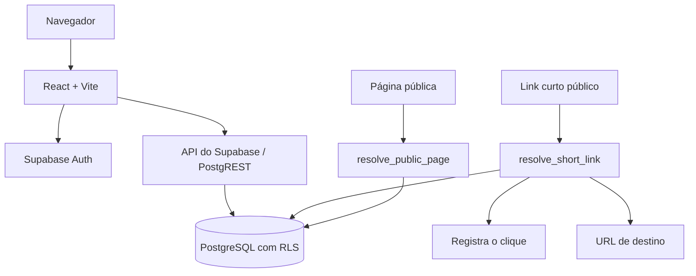

# LinkForge

**Encurte, compartilhe e acompanhe.**

Aplicação web para criar links curtos com alias personalizado, expiração, QR Code e contagem de cliques, além de páginas públicas que reúnem vários links (no estilo "link na bio"). Cada usuário só enxerga e altera os próprios dados: a regra fica no banco, com Row Level Security do PostgreSQL.

## Funcionalidades

- **Links curtos** para URLs HTTP/HTTPS, com código gerado ou alias escolhido (`/meu-portfolio`)
- **Sugestão de alias** a partir do endereço de destino (`.../blog/meu-artigo` → `meu-artigo`)
- **Expiração** em 24 h, 7 dias, 30 dias ou data personalizada, com conversão correta entre horário local e UTC
- **QR Code** de cada link, com download em PNG
- **Cliques**: contador, data do último acesso e histórico por link
- **Ativar, desativar, editar e excluir** links
- **Páginas públicas** (`/minha-pagina`) com título, descrição, avatar e lista ordenável de links (HTTP/HTTPS, `mailto:` e `tel:`)
- **Login e cadastro** por e-mail e senha (Supabase Auth)

## Segurança

| Regra | Onde é garantida |
|---|---|
| Cada usuário lê, altera e apaga só os próprios links e páginas | Políticas RLS por `owner_id` |
| Ninguém cria registro em nome de outro usuário | RLS `WITH CHECK (auth.uid() = owner_id)` |
| Histórico de cliques visível só para o dono do link | RLS em `click_events` |
| Visitante sem login não acessa as tabelas | Nenhuma política para `anon` |
| O redirecionamento público conta o clique sem abrir a tabela | Função `resolve_short_link` (`SECURITY DEFINER`, `search_path` fixo) |
| A página pública não expõe o dono | Função `resolve_public_page` devolve só os campos públicos |
| Alias não pode coincidir com rotas do app (`/links`, `/login`…) | Validação no front e na função `check_code_available` |
| URLs perigosas são recusadas (`javascript:`, `data:`, `file:`, `vbscript:`, `usuario@host`) | `src/utils/url.ts` e `src/utils/pageLinkUrl.ts` |

Essas regras são verificadas por um teste de integração que roda contra um Supabase real (veja [Testes](#testes)).

## Stack

React 18 · TypeScript · Vite · Tailwind CSS · React Router · Supabase (Auth + PostgreSQL) · Vitest

## Arquitetura



O painel faz operações autenticadas, filtradas pelo RLS. Links curtos e páginas públicas passam por funções do banco com permissões restritas, sem liberar as tabelas para visitantes.

## Rodar localmente

Não precisa de conta no Supabase: a [CLI do Supabase](https://supabase.com/docs/guides/local-development) sobe o banco, a autenticação e a API em containers Docker e aplica as migrations de `supabase/migrations/`.

Pré-requisitos: Node.js 20+ e Docker.

```bash
npm install
npx supabase start          # sobe o Supabase local e mostra a API URL e a anon key
cp .env.example .env        # preencha com os valores mostrados acima
npm run dev                 # http://localhost:5173
```

`.env`:

```env
VITE_SUPABASE_URL=http://127.0.0.1:54321
VITE_SUPABASE_ANON_KEY=<anon key mostrada pelo supabase start>
```

A `anon key` é pública por natureza; quem protege os dados são as políticas RLS. Nunca coloque a `service_role` ou a senha do banco no front-end.

Para desligar: `npx supabase stop`.

## Testes

```bash
npm test            # testes unitários (Vitest): validação de URL, alias, expiração e datas
npm run test:rls    # integração: regras de segurança contra o Supabase local
npm run check       # typecheck + lint + testes unitários + build
```

O `test:rls` cria dois usuários de teste e confirma, entre outras coisas, que um não lê, altera nem apaga os links do outro, que um visitante não grava cliques falsos e que link desativado não redireciona. Ele se recusa a rodar fora de `localhost`.

## Banco de dados

Migrations, em ordem:

1. `20260924211114_create_linkforge_schema.sql`: tabelas, índices e as funções públicas
2. `20260925153931_linkforge_security_and_ownership.sql`: adiciona `owner_id`, troca as políticas abertas do protótipo por políticas por dono, cria `resolve_public_page` e as restrições de formato de alias e slug
3. `20261110120000_owner_id_default.sql`: o banco preenche `owner_id` com o usuário logado. Sem isso, as políticas recusavam todo link ou página criados pelo app, que não envia esse campo.

Registros criados antes da segunda migration ficam com `owner_id` nulo: continuam funcionando pelos links públicos, mas não aparecem em nenhum painel.

## Deploy

O front é estático (Vite) e o `vercel.json` já traz o fallback de rotas do React Router. Em um projeto Supabase, aplique as duas migrations, configure `VITE_SUPABASE_URL` e `VITE_SUPABASE_ANON_KEY` na hospedagem e ajuste a URL do site em **Authentication → URL Configuration**.

## Como foi desenvolvido

O protótipo foi gerado no [Bolt.new](https://bolt.new). Depois, com apoio de IA (Claude Code), o código foi revisado: separação de dados por usuário, testes unitários e de segurança, correção de bugs encontrados pelos testes e documentação.

## Próximos passos

- Redirecionamento server-side (HTTP 302) em Edge Function
- Limite de requisições e proteção contra spam
- Analytics por período, origem e dispositivo
- Domínios personalizados
